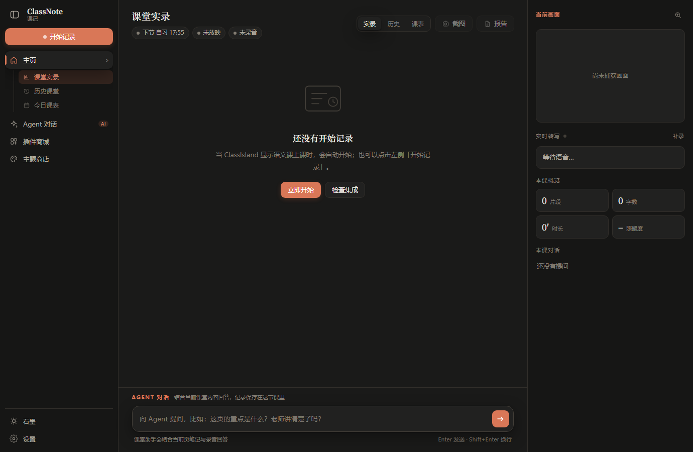
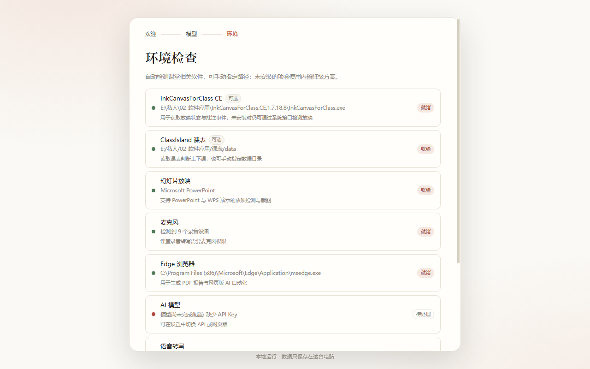

# ClassNote · 课记

> 一个跑在 Windows 上的本地课堂助手：自动跟随幻灯片翻页、实时转写讲解、逐页生成 AI 笔记，并在下课时交出一份图文并茂的课堂报告（HTML + PDF）。

ClassNote 面向真实的教学环境设计：它不要求教师改变上课习惯，也不需要把课堂内容上传到某个云端平台。程序以 Go 编写，单文件运行，界面是本地网页，数据全部保存在程序所在目录。



---

## 目录

- [它能做什么](#它能做什么)
- [30 秒上手](#30-秒上手)
- [工作原理](#工作原理)
- [配置说明](#配置说明)
- [与 ClassIsland / InkCanvasForClass 联动](#与-classisland--inkcanvasforclass-联动)
- [数据目录](#数据目录)
- [构建](#构建)
- [已知限制](#已知限制)
- [常见问题](#常见问题)
- [开源许可](#开源许可)

---

## 它能做什么

| 能力 | 说明 |
| --- | --- |
| **自动跟页** | 检测 PowerPoint / WPS 演示的放映状态，翻页瞬间抓取当前页。优先通过 COM 导出高清原图（1920×1080、无遮挡、无批注），失败时回退到窗口截图 + 感知哈希比对 |
| **随堂转写** | 麦克风采集 → 能量检测断句 → 语音转写接口（或本地 whisper.cpp），按页归档 |
| **逐页 AI 笔记** | 每页停留结束时，把「画面文字 + 录音转写 + 上一页要点」交给模型，输出结构化笔记、要点、易错点 |
| **照搬判定** | 判断教师是否在逐字念 PPT，给出 0–100 的照搬分与证据；没有语音证据时明确标为「未判定」，不瞎猜 |
| **课堂报告** | 下课后汇总为 HTML 报告，先给讲授方式判断，再是逐页笔记与实录摘录，最后用浏览器内核渲染成 PDF |
| **课表联动** | 直接解析 ClassIsland 的课表文件，判断上下课与学科；只监听你勾选的学科（默认语文） |
| **ClassIsland 注入插件** | 随包提供 ClassIsland 插件（`classnote.islandbridge`）：上课/下课、当前科目、下一节课实时注入，还能让 ClassIsland 弹出课堂提醒 |
| **ICC 插件** | 随包提供 `ClassNote.Bridge.dll`，注入后 ICC 的放映状态实时推送到 ClassNote |
| **系统托盘** | 原生托盘图标：右键开始/结束记录、打开报告目录、状态气泡；图标丢失自动重挂 |
| **本地语音转写** | whisper.cpp 随包分发、启动即用、完全离线；中文实测可用 |
| **桌面悬浮球** | 常驻屏幕右上角、可拖动，显示课堂状态与计时，悬停展开，点开主界面 |
| **右侧导航栏** | 仿 ClassIsland 的右侧竖栏，可展开/收拢；主页 / Agent / 插件商城 / 主题商店 |
| **局域网访问** | 手机/平板用带密钥的链接访问；密钥随机生成、可改可持久化，非回环请求强制校验 |
| **机器人通知** | 企业微信 / 钉钉 / 飞书 / Telegram / Server酱 / Discord / Slack / Bark / PushPlus / ntfy / Gotify / 自定义 Webhook，快速添加可搜索 |
| **主题商店** | 4 套内置 + 自定义取色编辑（实时预览）+ 导出导入 + 社区主题一键安装 |
| **插件商城** | 市场 / 已安装双标签，搜索、安装、启停、编辑提示词；下载量与评分展示 |
| **Agent 页** | 独立聊天页：课堂上下文模式 + 通用模式，快捷问题，按课保存对话 |
| **Agent 对话** | 主页随时向 Agent 提问，对话记录按课保存；历史课堂下可展开每节课的对话记录 |
| **技能包与权限** | 本地技能包（JSON）注入课堂助手指令；权限三档：全部访问 / 敏感提醒 / 人工审查 |
| **一键更新** | 关于页检查新版本后直接下载更新包、安装并重启，全程不离开应用 |
| **双端 UI** | 同一套界面既能在本地应用窗口打开，也能用浏览器访问；四套主题（羊皮纸 / 石墨 / 雾蓝 / 松林） |



---

## 30 秒上手

### 直接运行

1. 下载 Release 中的 `ClassNote-<版本>-windows-amd64.zip`，解压到任意目录（不要放在 `C:\Program Files` 下，避免写权限问题）。
2. 双击 `ClassNote.exe`。首次启动会弹出引导页：
   - **欢迎** → 了解它能做什么；
   - **模型** → 选一个 API 服务商填入 Key，或切到「网页版 AI」用浏览器登录；
   - **环境** → 自动检测 PowerPoint / WPS、麦克风、ClassIsland、InkCanvasForClass。
3. 进入主界面。上课时点击右侧「开始记录」，或者让 ClassIsland 自动触发。

> 程序会在 `127.0.0.1:41735` 起一个本地服务，并用 Edge 的应用模式打开窗口。想用浏览器访问，直接打开 `http://127.0.0.1:41735` 即可。

### 命令行参数

```text
ClassNote.exe [参数]

  -port int        本地服务起始端口（默认 41735）
  -no-window       只启动服务，不打开应用窗口
  -browser         用默认浏览器打开界面
  -v               日志同时输出到控制台
  -reset           重置配置（保留课堂记录）
```

---

## 工作原理

```text
                 ┌──────────────────────────────┐
   ClassIsland ──┤ 课表解析（上下课 / 学科）      │
                 └──────────────┬───────────────┘
                                │ 上课 / 下课
                 ┌──────────────▼───────────────┐
   PowerPoint ───┤ 放映检测（COM / 窗口 / 哈希） │
   WPS 演示   ───┤ 翻页 → 截图 + PPTX 文字      │
                 └──────────────┬───────────────┘
                                │ 每页材料
   麦克风 ────────► 断句 ──► ASR ─┤
                                │
                 ┌──────────────▼───────────────┐
                 │ 逐页分析（AI）                │
                 │ 笔记 / 要点 / 照搬评分        │
                 └──────────────┬───────────────┘
                                │ 下课后汇总
                 ┌──────────────▼───────────────┐
                 │ 报告 HTML → CDP 打印 PDF      │
                 └──────────────────────────────┘
```

几个关键设计：

1. **翻页是分段的唯一依据。** 每次翻页会立刻结算上一页：把残留音频送去转写、把这一页的转写归档、然后才开始新一页。这样「这一页讲了什么」不会串页。
2. **画面文字优先从 PPTX 里读。** `.pptx` 本质是 zip + XML，直接解析 `ppt/slides/slideN.xml` 里的文本节点，比截图 OCR 准，也不需要额外依赖；文件读不到时再依赖模型看图。
3. **COM 优先，截图兜底。** PowerPoint / WPS 的 COM 接口能拿到精确页码并导出干净的原图；接口不可用或被占用时，退回到 `PrintWindow`（能穿透其它置顶窗口）再退到屏幕 BitBlt。
4. **单进程、无 cgo。** 屏幕捕获、录音、COM、浏览器自动化全部走系统 API 或纯 Go 实现，`go build` 即可产出单文件。

---

## 配置说明

所有配置保存在程序目录的 `config.json`，也可以在界面「设置」里改。

### 模型

- **API 接入**：任何 OpenAI 兼容接口（DeepSeek、通义千问、Kimi、智谱、SiliconFlow、OpenAI、Ollama、中转站）以及 Anthropic 原生协议。
- **视觉**：勾选「模型支持图片理解」后，每页会连同截图一起发给模型；不勾选则只发文字。
- **网页版 AI**：用浏览器自动化操作 chat.qwen.ai / chat.deepseek.com。首次需在设置里点「打开登录」完成一次登录，登录态保存在 `data/webprofile`。网页版没有真正的 API，速度取决于页面响应（实测单页约 20–40 秒）。

> 想要最好的效果，建议用支持视觉的 API 模型；网页版适合没有 Key 或想先用起来的情况。

### 语音

| 模式 | 说明 |
| --- | --- |
| `api` | OpenAI 兼容的 `/audio/transcriptions`。SiliconFlow 的 `FunAudioLLM/SenseVoiceSmall` 免费且中文效果好 |
| `local` | 本地 whisper.cpp，指定 `main.exe` 与 `ggml-*.bin` |
| `off` | 不转写，只记幻灯片 |

阈值越低越灵敏；教室噪声大时把「语音阈值」调高一点。没有麦克风时仍可正常记录幻灯片，也可以用「补录」按钮手动输入转写。

### 截图

- **轮询间隔**：默认 700ms。COM 可用时开销很小。
- **高清导出**：优先用 COM 导出 1920×1080；关掉后只用窗口截图。
- **裁掉黑边**：自动去掉放映时的上下/左右黑边。
- **差异阈值**：窗口截图模式下判断「画面变了没有」，越大越迟钝。

### 课堂

- **监听学科**：默认只有「语文」。只有这些学科的课表时段才会自动开始记录。
- **自动开始 / 结束 / 生成报告**：自动结束只作用于「由课表自动开始」的课堂，手动开始的不会被误停。
- **备用课表**：ClassIsland 没开时，可以按「周一 08:00-08:40 语文」的格式手写。

---

## 与 ClassIsland / InkCanvasForClass 联动

### ClassIsland

ClassIsland 2.x 的课表是 JSON：`data/Profiles/*.json` 里有 `TimeLayouts`（时间轴）、`ClassPlans`（周几上什么课）、`Subjects`（科目）。ClassNote 直接读这些文件，按当前时间算出「现在是不是在上课、上什么课、下一节是什么」，因此 **ClassIsland 不开也能用**，只要数据目录在。

定位顺序：设置里的路径 → 运行中进程的安装目录 → `%APPDATA%\ClassIsland` → 手动指定。

### ClassIsland 注入插件（推荐）

读文件有 30 秒缓存，遇到临时换课、提前下课会有延迟。装上限定的注入插件后，ClassIsland 会把真实状态直接推过来：

- 插件 id：`classnote.islandbridge`，入口 `ClassNote.IslandBridge.dll`，目标 API 2.0。
- 安装：设置 → 集成 → 「安装 / 更新插件」，写入 `data/Plugins/classnote.islandbridge/`，重启 ClassIsland 生效。
- 接口：`GET http://127.0.0.1:51888/state` 返回当前科目、起止时间、下一节课、时间状态；`POST /notify` 让 ClassIsland 弹出提醒。
- 插件只在回环地址监听，不对外网开放；ClassNote 每 2 秒拉取一次，并与文件解析结果合并（插件优先）。
- 源码在 `integrations/classisland-bridge/`，可用 `dotnet build -c Release` 重新编译。

### InkCanvasForClass CE

ICC 的主窗口本身就是一层全屏透明覆盖层，所以「窗口是不是全屏」不能用来判断是否在放映。ClassNote 的做法是：

- **放映检测不依赖 ICC**：直接问 PowerPoint / WPS 的 COM 接口，或看放映窗口类名（`screenClass` 等），ICC 开着也不会干扰。
- **截图不被批注遮挡**：优先走 COM 导出原图；走窗口截图时用 `PrintWindow`，拿到的是窗口自身内容而不是屏幕像素。
- **事件桥（可选）**：任何外部程序都可以把 ICC 的状态推给 ClassNote：

```http
POST http://127.0.0.1:41735/api/integrations/icc/event
Content-Type: application/json

{ "event": "slideshow_start", "presenting": true, "slide": 3 }
```

**插件是随包提供的**（`plugins/ClassNote.Bridge.dll`，.NET Framework 4.7.2，对应 ICC 1.7.x）。
点「注入插件」会做三件事：复制 DLL 到 `<ICC>/Plugins/`、在 `Configs/PluginConfig.json` 里登记并启用、
写一份卸载说明。注入后重启 ICC 即可生效，移除时反向操作。

插件只做一件事：每秒读一次 ICC 的放映状态与页码，变化时（以及每 20 秒心跳）POST 一个事件过来。
实测在 ICC 1.7.18.8 上，插件自带的窗口探测比 `IGetService.IsPPTMode` 更可靠——
后者在这台机器上即使已经连上放映仍返回 `false`，所以插件以窗口特征为准。

需要为你自己的 ICC 版本重新编译时：

```powershell
cd integrations\icc-bridge
.\build.ps1 -IccDir "E:\...\InkCanvasForClass.CE.x.y.z"
```

---

## 数据目录

```text
ClassNote.exe
config.json                 # 配置（含 API Key，注意不要提交到仓库）
data/
  sessions/<id>.json        # 每堂课的结构化记录
  captures/<id>/*.jpg       # 逐页截图
  reports/<id>.html|.pdf    # 课堂报告
  logs/app-YYYYMMDD.log     # 运行日志
  webprofile/               # 网页版 AI 的浏览器登录态
  pdfprofile/               # 打印 PDF 用的独立浏览器配置
  runtime.json              # 端口与进程信息，供外部脚本对接
```

---

### 语音模型（可选，发布包已自带）

发布包里已经带了语音模型，开箱即用。如果你是克隆仓库自己编译，先下载模型：

```powershell
powershell -ExecutionPolicy Bypass -File scripts\get-whisper.ps1
```

可选参数 `-Model base-q5_1`（更轻量）或 `-Model medium-q5_1`（更准）。

## 构建

需要 Go 1.22+（Windows）。项目没有 cgo 依赖。

```powershell
# 开发构建（带控制台，方便看日志）
go build -o ClassNote-debug.exe .

# 发布构建（无控制台窗口）
go build -ldflags "-H windowsgui -s -w -X main.version=1.0.0" -o ClassNote.exe .

# 打包
powershell -ExecutionPolicy Bypass -File build.ps1
```

`build.ps1` 会依次完成：编译 GUI 版与调试版 → 复制文档 → 生成 zip 到 `dist/`。

---

## 已知限制

这些是实际测试中确认的边界，写在这里避免误导：

1. **网页版 AI 不能可靠上传图片。** chat.qwen.ai 的文件输入框在 CDP 下能触发 `change` 事件，但页面不会生成附件预览，实测无法稳定把截图送进对话。因此网页版模式下，笔记依赖**从 PPTX 提取的文字 + 语音转写**；需要「看图」请用支持视觉的 API 模型。
2. **ICC 插件与版本绑定。** 插件按 ICC CE 1.7.18.8 的 `EnhancedPluginBaseV2` 接口、.NET Framework 4.7.2 编译，已在真机验证加载、启用、事件推送。ICC 升级到 1.8.x 后接口可能变化，需要按 `integrations/icc-bridge` 里的工程重新编译（`build.ps1` 一条命令）。即使插件不生效，ClassNote 自己的 COM / 窗口检测仍然工作，功能不受影响。
3. **WPS 的 COM 支持取决于配置。** WPS 需在「配置工具 → 兼容设置」里勾选「WPS Office 兼容第三方系统和软件」，否则拿不到 `KWPP.Application`，此时会退回窗口截图。
4. **PPT 文本提取只支持 `.pptx`。** 旧的 `.ppt` 二进制格式读不了，会用截图 + 模型看图代替。
5. **语音转写已随包自带。** whisper.cpp 与 small-q5_1 模型随程序分发，首次启动自动部署到 `C:\ProgramData\ClassNote\whisper`（whisper 是 C 程序、读不懂中文路径，所以要放在 ASCII 目录）并常驻运行，完全离线、无需安装。中文识别对同音字（如「荷塘月色」→「和堂乐色」）仍有误差，属本地小模型的正常水平；要更高精度可换 medium 模型或用云端接口。
6. **DeepSeek 网页版在某些网络下被限流。** 本机 curl 请求 chat.deepseek.com 会返回 429，但真实浏览器可以正常打开登录页；接入流程与千问一致（设置 → 模型 → 网页版 → 登录）。API 模式的 DeepSeek 预设不受影响。
7. **只在 Windows 上测试。** 代码使用了 Win32 API，macOS / Linux 无法编译。

---

## 常见问题

**Q：双击没反应？**
看 `data/logs/` 下最新的日志。常见原因是端口被占用（换 `-port`）或程序目录没有写权限（不要放 `Program Files`）。

**Q：能识别 WPS 吗？**
能，但需要 WPS 打开 COM 兼容开关（见上）。检测逻辑同时匹配 `wpp.exe` / `wps.exe` 的放映窗口。

**Q：为什么笔记里写「本页缺少语音证据」？**
说明这一页没有可用的转写（麦克风没开、环境太吵、或 ASR 没配置）。程序不会在这种情况下编造老师说过的话，照搬分也会标为「未判定」。

**Q：报告里的照搬分是怎么算的？**
每页由模型给出 0–100 的分与证据，整堂课按转写长度加权平均。阈值：≥70 疑似照搬、40–69 部分照搬、<40 以讲解为主。没有语音的页不计入。

**Q：数据会上传吗？**
只有你配置的模型接口会收到「画面文字 + 转写文本」（勾选视觉时还有截图）。课堂记录、截图、报告都只在本机。

---

## 开源许可

本项目以 **MIT License** 发布，详见 [LICENSE](LICENSE)。

第三方组件：

| 组件 | 用途 | 许可 |
| --- | --- | --- |
| [go-rod/rod](https://github.com/go-rod/rod) | 浏览器自动化（网页版 AI、PDF 打印） | MIT |
| [go-ole/go-ole](https://github.com/go-ole/go-ole) | PowerPoint / WPS 的 COM 调用 | MIT |
| [golang.org/x/sys](https://pkg.go.dev/golang.org/x/sys) | Win32 API 绑定 | BSD-3-Clause |

ClassNote 与 ClassIsland、InkCanvasForClass、WPS、Microsoft Office 均无隶属关系，仅在本地通过公开接口与之协作。

---

<p align="center"><sub>ClassNote · 让每一页板书都留下痕迹</sub></p>
